<p align="center">
  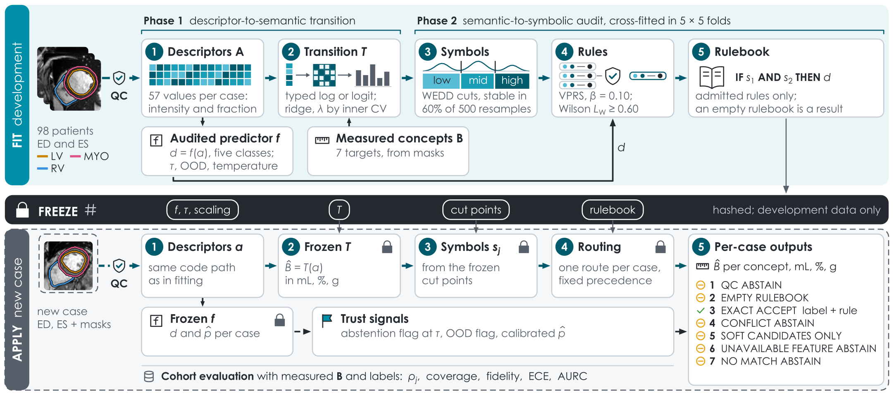
</p>

<h1 align="center">CINETRA</h1>
<p align="center"><b>A multi-vendor audit of semantic concept transfer in cardiac MRI</b><br>
Code, registered protocol, frozen results and fitted bundles of a once-only, registered evaluation</p>

<p align="center">
  <a href="protocol/registration/README.md"></a>
  <a href="#reproduce-the-study"></a>
  <a href="LICENSE"></a>
  <a href="#licences"></a>
  <a href="#licences"></a>
  
  
  
</p>

**CINETRA** (cine semantic transition) audits what a frozen cardiac MRI classifier encodes, in the quantities a
reader measures: ventricular volumes, ejection fractions and myocardial mass. A typed linear transition maps the
classifier's 57 mask descriptors to these measured concepts; variable-precision rough-set rules on the concepts
must survive a cross-fitted gate before they may label a case; and every case receives one reason-coded route,
a label or a computational abstention. The audit was registered as a signed protocol, frozen, and evaluated once
on three public cohorts, one of them held out and unread until the registration.

> **Manuscript in preparation.** P. Radiuk, O. Barmak, L. Klymenko and I. Krak, *CINETRA: A Multi-Vendor Audit of
> Semantic Concept Transfer in Cardiac MRI*. This repository is the study's public record. It is research
> software, not a medical device, and must not be used for clinical decisions.

## Contents

- [Key results](#key-results)
- [How CINETRA works](#how-cinetra-works)
- [Study design](#study-design)
- [Confirmatory scorecard](#confirmatory-scorecard)
- [Limitations and negative results](#limitations-and-negative-results)
- [Reproduce the study](#reproduce-the-study)
- [What is in this repository](#what-is-in-this-repository)
- [Data availability](#data-availability)
- [Licences](#licences)
- [How to cite](#how-to-cite)
- [Use of generative AI](#use-of-generative-ai) · [Acknowledgments](#acknowledgments) · [Authors](#authors)

## Key results

| | |
|---|---|
| **Registered before evaluation** | The protocol was fixed in two signed git tags, on 29 September and 3 October 2026. The M&Ms-2 images stayed unread until the second; anyone can [verify the signatures and the registered files](protocol/registration/README.md). |
| **Internal transfer** | On the ACDC test set (50 patients; registered after unblinding), the frozen transition reconstructed the seven primary concepts with a skill score **ρ = 0.553** (95% CI 0.473–0.619): every concept improved on the development mean, from LV mass (0.387) to LVEF (0.794). **H1 passed.** |
| **Prospective external transfer** | On 180 held-out M&Ms-2 subjects from three vendors, the unchanged bundle reached **ρ = 0.311** (95% CI 0.233–0.382). **H3 passed.** |
| **Ejection fractions transfer** | Across vendors, LVEF and RVEF kept most of their skill: **ρ_EF = 0.606** on M&Ms-2 (97.5% CI 0.558–0.652). **H4a passed.** |
| **Descriptors beat a learned basis** | The 57 mask-conditioned descriptors reconstructed the concepts better than a frozen ImageNet ResNet-50 on every cohort; the ResNet-50 had no skill even internally (ρ = 0.038). |
| **Reproducible to the byte** | A full re-execution reproduced 242 of 252 outputs byte for byte (the other 10 differ only in run metadata), and the code here is byte-identical to the registered commit that produced the results. |

<p align="center">
  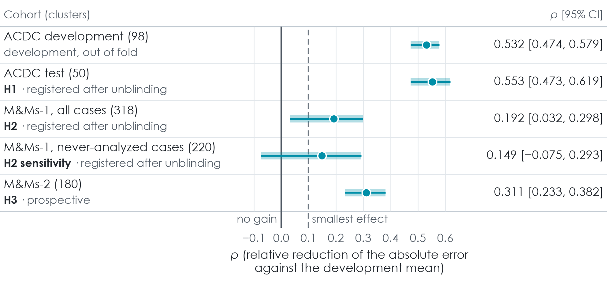
  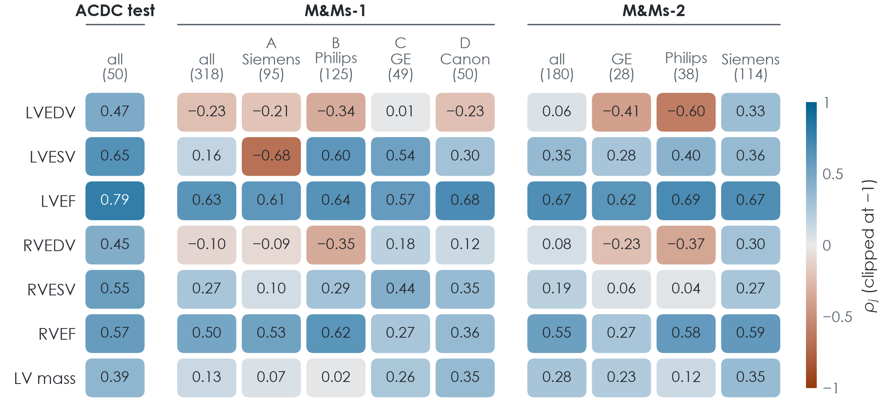
</p>
<p align="center"><sub><b>Figure 3.</b> Skill score ρ by cohort (solid line: no gain over the development mean; dashed: the
smallest effect of interest, 0.10). <b>Figure 4.</b> ρ per concept, cohort and vendor stratum: ejection fractions
transfer, end-diastolic volumes do not.</sub></p>

## How CINETRA works

CINETRA is an audit layer around a frozen predictor, a multinomial logistic regression on 57 deterministic
descriptors of the end-diastolic and end-systolic images and their expert masks.

1. **Descriptor-to-semantic transition.** A typed ridge transition **T**, with per-target transforms, observation
   masks and penalties chosen by inner cross-validation, maps the descriptors **A** to the measured concepts and
   returns the reconstruction **B̂** in physical units.
2. **Semantic-to-symbolic audit.** Weighted entropy–density discretization turns **B̂** into symbols;
   variable-precision rough-set rules whose consequent is the audited decision are admitted only if they recur in
   held-out folds and pass a pooled Wilson bound of 0.60.
3. **Reason-coded routing.** Every case receives exactly one route: `QC ABSTAIN`, `EMPTY RULEBOOK`, `EXACT ACCEPT`,
   `CONFLICT ABSTAIN`, `SOFT CANDIDATES ONLY`, `UNAVAILABLE FEATURE ABSTAIN` or `NO MATCH ABSTAIN`. Only
   `EXACT ACCEPT` emits a label; conflicts are never resolved by score.
4. **Trust signals.** Selective prediction, label-free out-of-distribution flags and temperature scaling, fitted
   in development and frozen before evaluation; a label-free location–scale re-standardization of the target
   cohort tests whether the external loss is a simple shift.

Every fitted object is frozen into a hashed bundle before any new case is processed. The method extends the
SEMTRA audit sequence and the typed targets of CARDIA-X; the full specification is
[SPECIFICATION.md](SPECIFICATION.md) (public edition of the registered protocol).

<p align="center">
  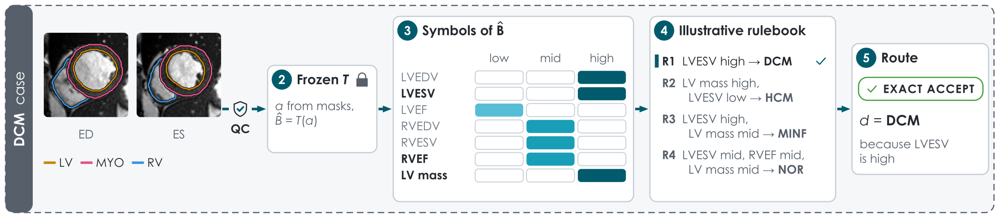
  
</p>
<p align="center"><sub><b>Figure 2.</b> A <b>hypothetical illustration</b> of the pipeline on five ACDC test scans (not study
output): one DCM case from its contours through <b>T</b> and the concept bins to an illustrative rulebook and its route,
then HCM, MINF, NOR and ARV cases. Images: ACDC, CC BY-NC-SA 4.0.</sub></p>

## Study design

| Cohort | Role | Cases (clusters) | Exposure |
|---|---|---|---|
| ACDC development | Fit, selection, thresholds | 98 patients, single centre, five classes | Development |
| ACDC test | Internal test (H1) | 50 | Registered after unblinding |
| M&Ms-1 | Historical external test (H2); 220 never-analysed cases as a sensitivity stratum | 320 (318); four vendors, five centres | Registered after unblinding |
| M&Ms-2 | Prospective external test (H3, H4) | 180 held-out subjects; three vendors | Prospective: unread until protocol 6.0.1 was signed |
| M&Ms-2 sealed half | Reserved for a later protocol | 180 | Never extracted |

- **Primary estimand.** The skill score ρ, the mean over the seven primary concepts (LV and RV end-diastolic
  volume, end-systolic volume and ejection fraction, and LV mass) of one minus the ratio of the transition's mean
  absolute error to that of the development mean. ρ = 0 means no gain over the mean.
- **Confirmatory tests.** Each hypothesis passes if the lower bound of its cluster-bootstrap interval (2000
  replicates) exceeds the smallest effect of interest, ρ = 0.10. H1 and H2 form a fixed sequence; H3 is its own
  family; the H4 family is Bonferroni-corrected (97.5% intervals) and confirmatory on M&Ms-2 only.
- **Comparators** (estimation only): a frozen ImageNet ResNet-50 (D20), a fine-tuned ResNet-18 (F9) with three
  seeds, a probe of F9's activations (F9b) and a CART surrogate (F8).

## Confirmatory scorecard

| Hypothesis | Cohort | Estimand | Estimate [interval] | Criterion | Decision |
|---|---|---|---|---|---|
| H1 | ACDC test (50) | ρ | 0.553 [0.473, 0.619] | lower bound > 0.10 | **Passed** |
| H2 | M&Ms-1 (318 clusters) | ρ | 0.192 [0.032, 0.298] | lower bound > 0.10 | **Failed** |
| H3 | M&Ms-2 (180) | ρ | 0.311 [0.233, 0.382] | lower bound > 0.10 | **Passed** |
| H4a | M&Ms-2 (180) | ρ_EF | 0.606 [0.558, 0.652] | lower bound > 0.10 | **Passed** |
| H4b | M&Ms-2 (180) | Δρ, label-free re-standardization | 0.001 [−0.019, 0.022] | lower bound > 0 | **Failed** |

Intervals: 95% percentile cluster bootstrap for H1–H3, two-sided 97.5% for H4. Every value comes from the frozen
run's records in [results/v6.0.1](results/v6.0.1/) (for example `metrics/primary_rho_*.json`,
`metrics/h_primary_3.json` and `metrics/confirmatory_h4/`).

## Limitations and negative results

The registration fixed what would be reported before the results were known, so the failures below are reported
with the same weight as the passes.

- **The historical cohort failed (H2).** On M&Ms-1, ρ fell to 0.192, and the 220 never-analysed cases gave 0.149
  (−0.075 to 0.293). The loss lay in the absolute volumes: LVEDV was reconstructed worse than by the development
  mean (ρ_j = −0.229), while LVEF (0.627) and RVEF (0.497) transferred. The voxel fractions in the descriptors are
  unitless, so absolute volumes depend on the field of view by design.
- **Label-free harmonization did not help (H4b).** Re-standardizing the descriptors on the unlabeled target cohort
  left ρ unchanged on M&Ms-2 (0.001) and lowered it on M&Ms-1 (−0.155). Resampling the ACDC test set to each
  vendor's spacing changed ρ by at most 0.044, but it leaves the field of view unchanged.
- **The primary rulebook was empty.** Six of the nine candidate concepts failed the cut-stability condition, and
  none of the six rules induced on the other three (LVESV, RVEF and LV mass) passed the gate, so every case was
  routed to `EMPTY RULEBOOK`. A synthetic gate-power analysis shows that the gate needs rules supported by about 15
  or more of the 98 development patients.
- **Trust signals did not transfer.** The 50% abstention threshold fitted in development covered only 0.324 of the
  M&Ms-2 cases; label-free out-of-distribution flags fired more often externally but did not detect errors
  (AUROC at most 0.5); and temperature scaling did not lower the calibration error of the audited predictor
  under shift.
- **The learned comparators were weak.** The frozen ResNet-50 had no concept skill even internally, and the
  fine-tuned ResNet-18 varied widely between seeds: 98 development patients are too few for a stable fine-tuned
  comparator.
- **Scope.** The descriptors use expert masks, so the audit describes a mask-derived representation, not an image
  model; the audited model is a transparent classifier, not a deep network; development used one centre; two
  cohorts had been analysed before the registration; and nothing here supports clinical validity or diagnostic use.

<p align="center">
  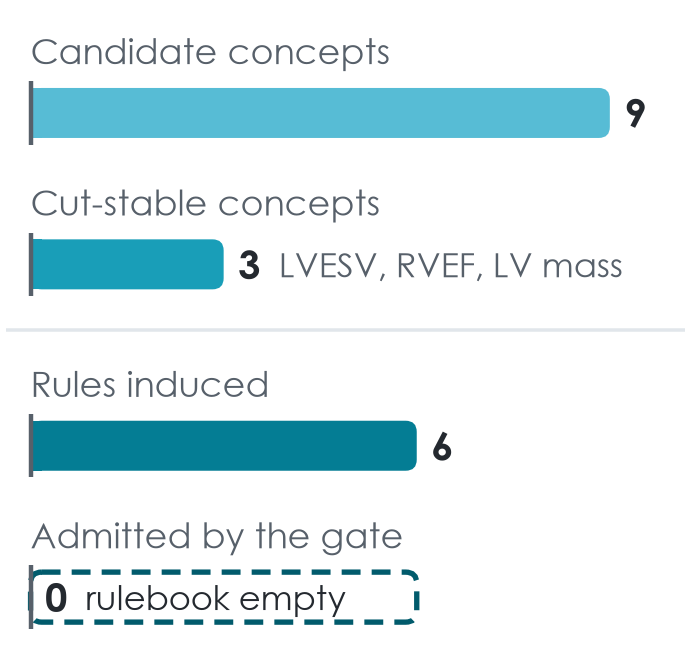
  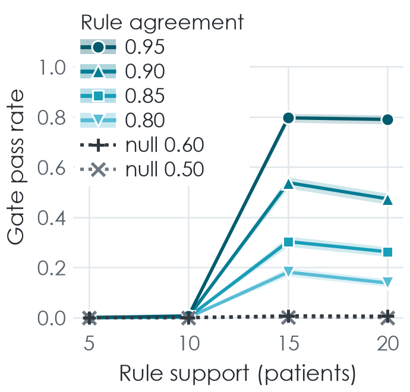
  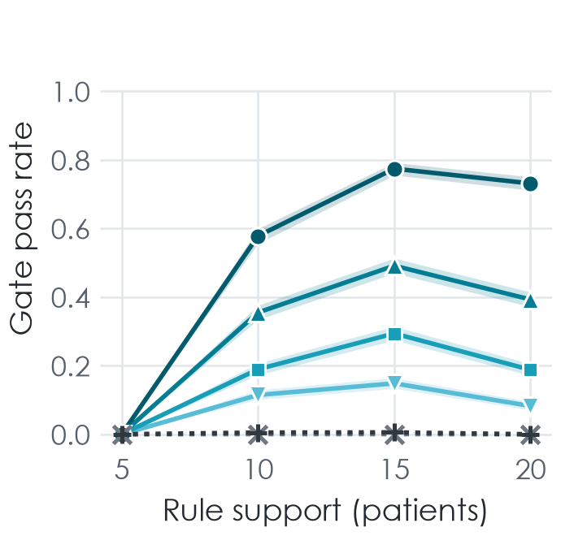
</p>
<p align="center"><sub><b>Figure 7.</b> Rule admission: the observed rule funnel on the development set (left) and the
gate power for synthetic planted rules through the full pipeline (middle) and the gate arithmetic alone (right).</sub></p>

<p align="center">
  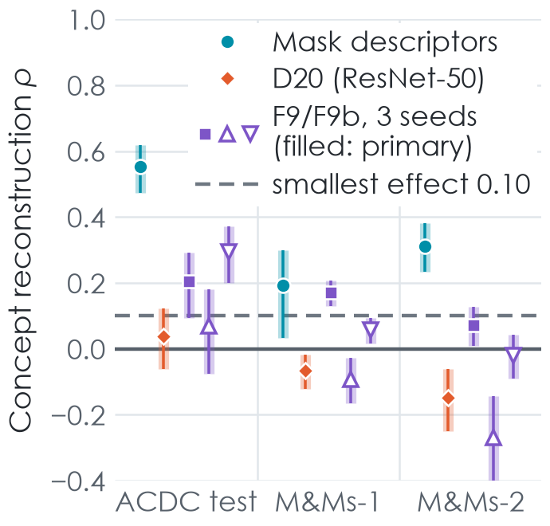
  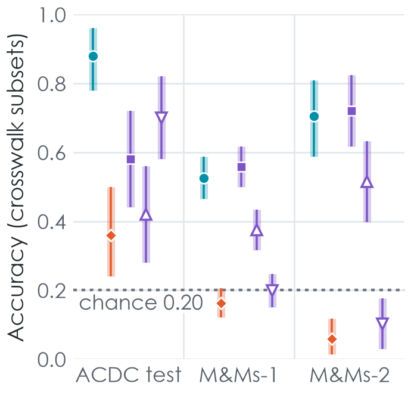
  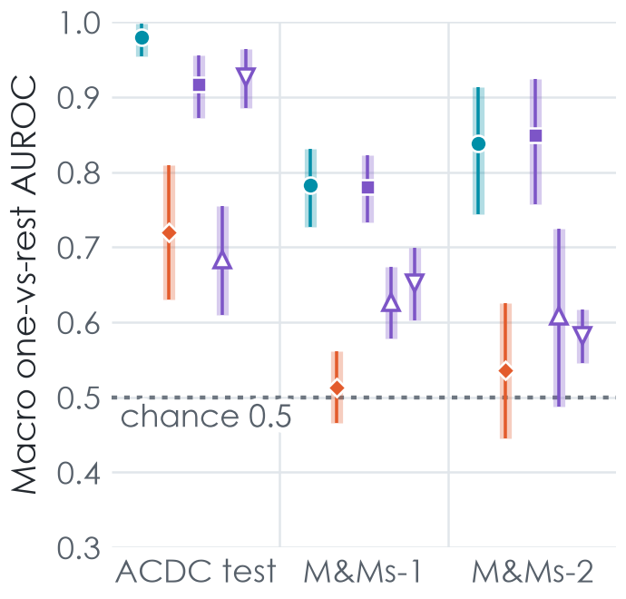
</p>
<p align="center"><sub><b>Figure 5.</b> Three representations, the descriptors, D20 and F9, by cohort: ρ (left), accuracy
(middle; chance 0.20) and macro AUROC (right).</sub></p>

<p align="center">
  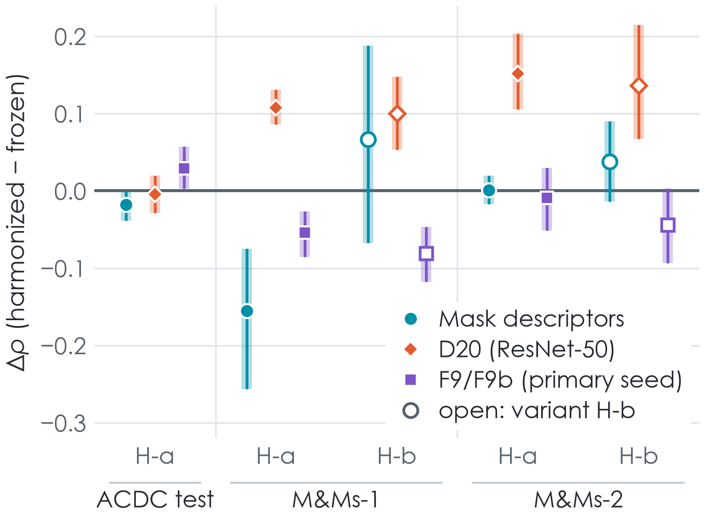
  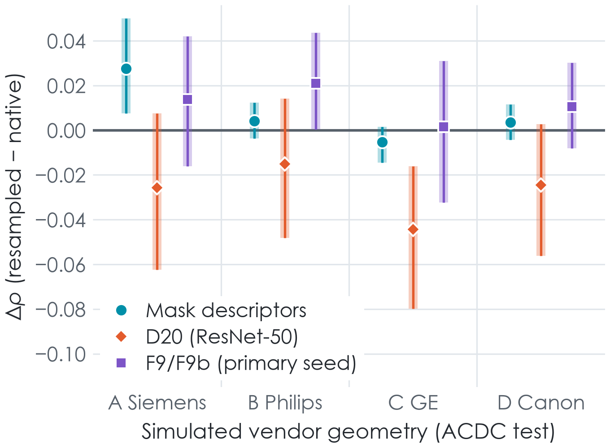
</p>
<p align="center"><sub><b>Figure 6.</b> Mechanism tests of the external shift: label-free re-standardization (left) and
resampling the ACDC test set to the spacing of each M&Ms-1 vendor (right).</sub></p>

<details>
<summary><b>Supplementary figures S1–S3</b></summary>

<p align="center">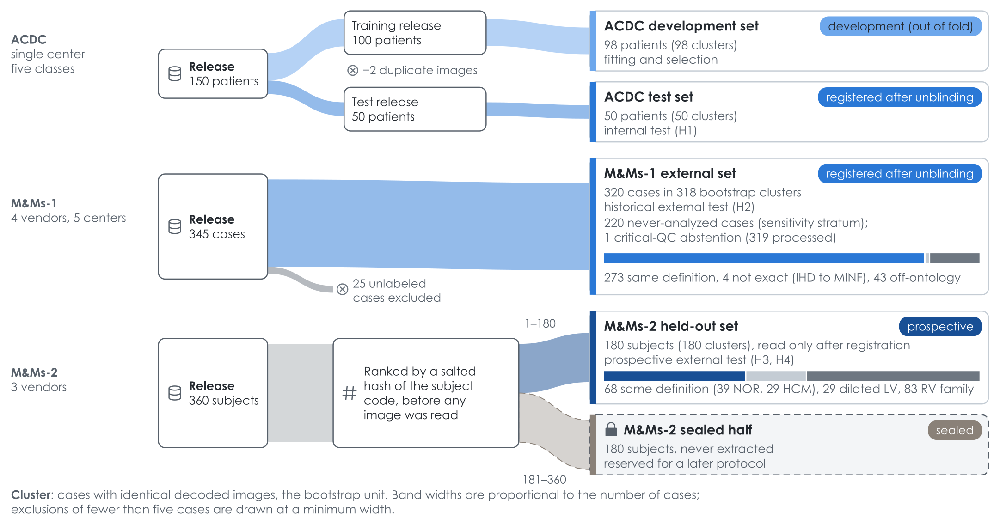</p>
<p align="center"><sub><b>Figure S1.</b> Cohort flow from each public release to the analysis sets; band widths are
proportional to the number of cases.</sub></p>

<p align="center">
  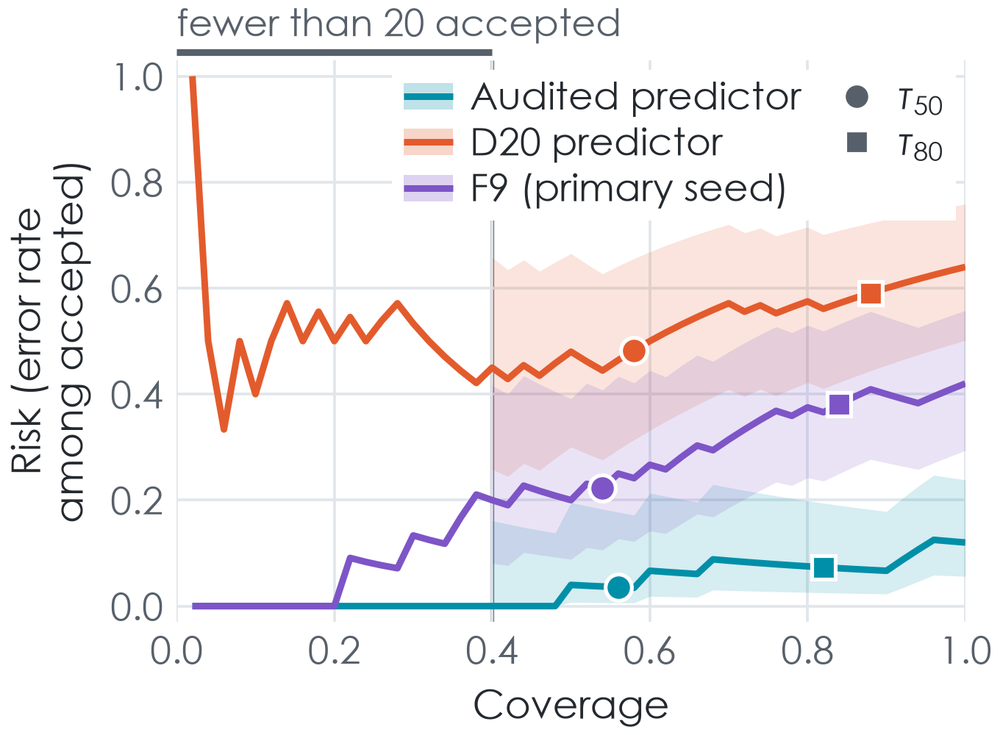
  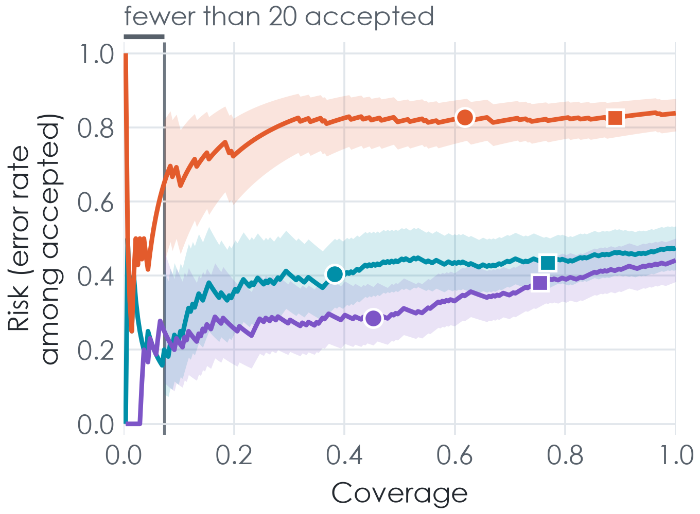
  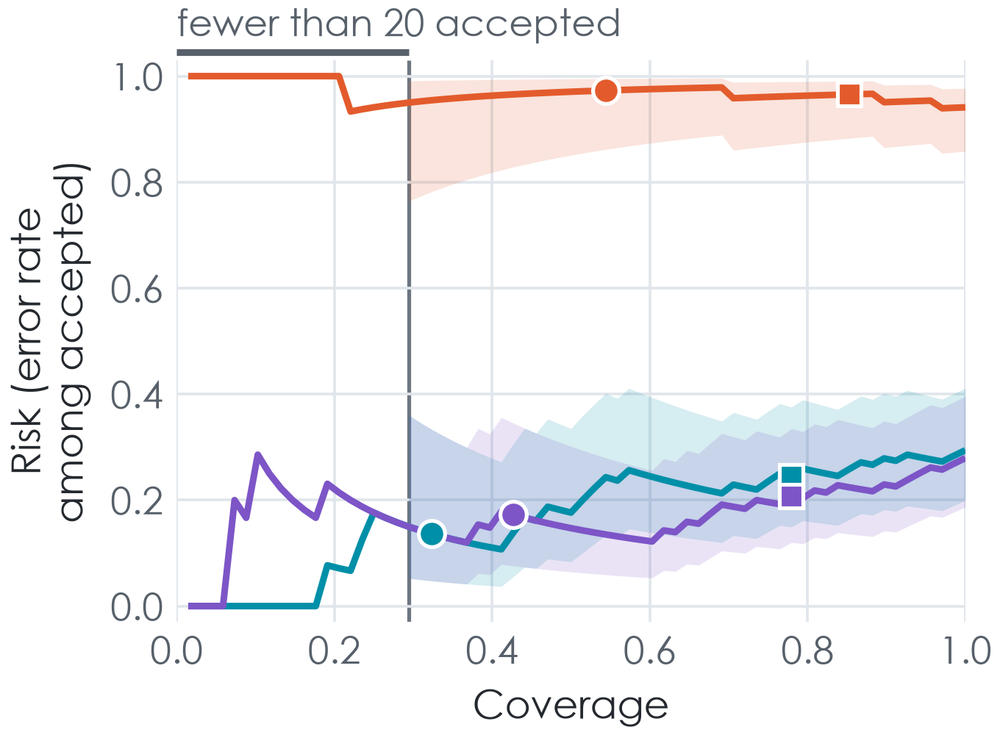
</p>
<p align="center"><sub><b>Figure S2.</b> Risk–coverage curves of the three predictors on the ACDC test set, M&Ms-1 and
M&Ms-2, with pointwise Wilson bands.</sub></p>

<p align="center">
  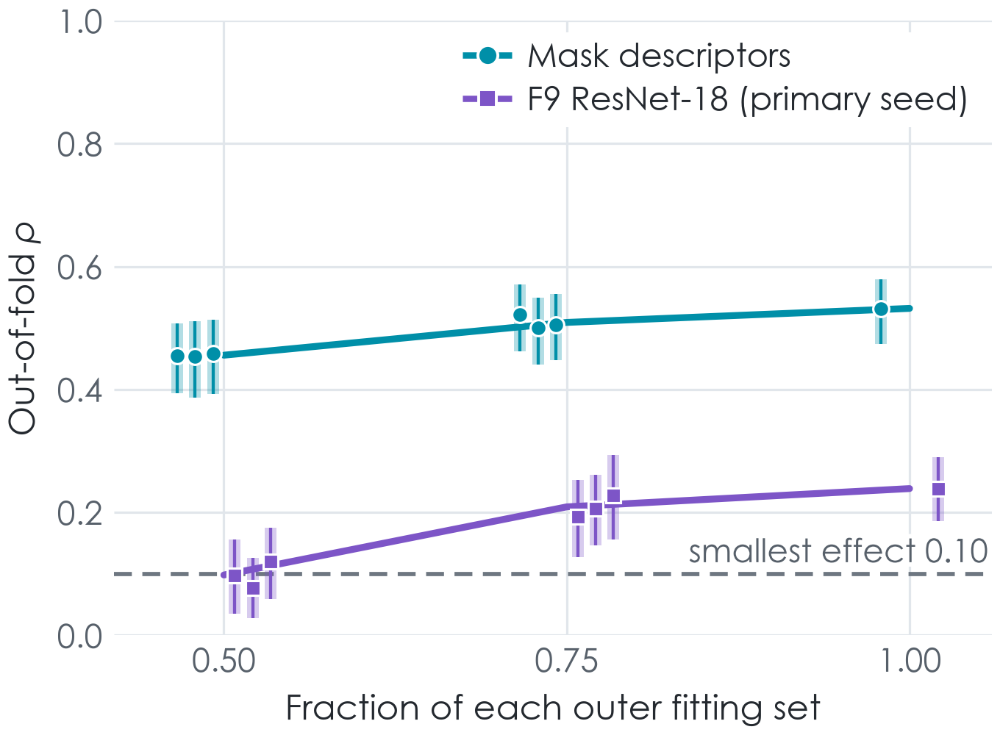
  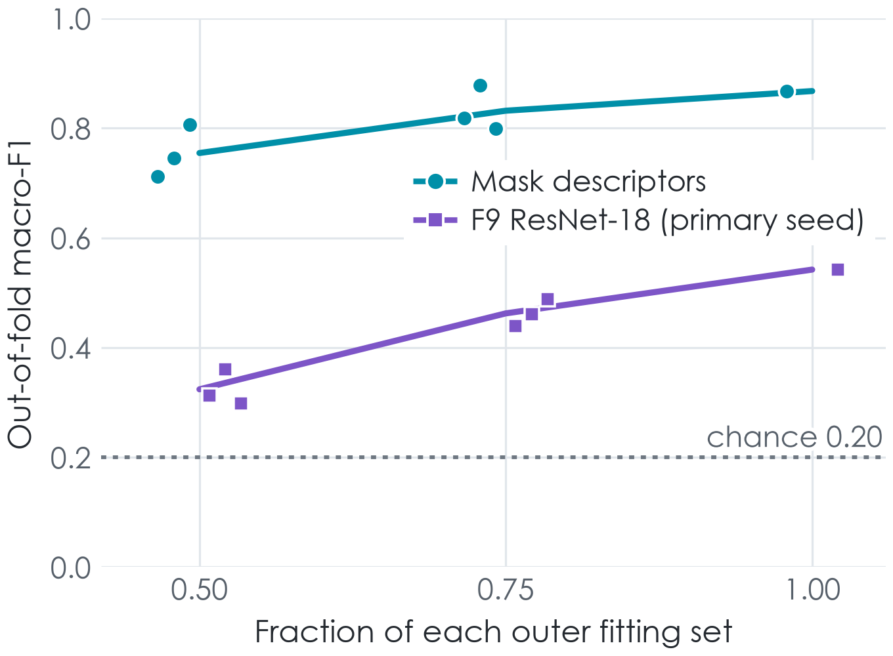
</p>
<p align="center"><sub><b>Figure S3.</b> Data efficiency on the ACDC development set: ρ (left) and macro-F1 (right) at
50%, 75% and 100% of each fitting set.</sub></p>
</details>

## Reproduce the study

```bash
git clone https://github.com/radiukpavlo/transition-matrix-cinetra.git && cd transition-matrix-cinetra
python tools/verify_registration.py                 # signatures, and the code is byte-identical to the registration
python tools/verify_data.py --acdc <ACDC database folder> --mms <M&Ms-1 folder> --mms2 <MnM2.rar>
docker compose build tmmri && docker compose run --rm -T tmmri python -m pytest -q
```

Then follow **[docs/REPRODUCTION.md](docs/REPRODUCTION.md)**: it lists every command of the original run in order,
the GPU and cloud options for the image comparators, and how to compare your run with the frozen results:

```bash
python tools/compare_results.py outputs/<your run id>
```

The environment is pinned end to end: Ubuntu 24.04 and CPython 3.12.14 by image digest, every Python package by
hash in `uv.lock`, IEEE FP32 with TF32 disabled on GPUs, and fixed seeds throughout.

## What is in this repository

```text
src/tmmri/                 the pipeline package and its CLI (python -m tmmri.cli), as registered
tests/                     the test suite (tests that need data or a GPU skip themselves)
configs/, registry/        the frozen configuration, semantic registry, reason codes and dataset manifests
SPECIFICATION.md           the protocol CMR-TRANS-AUDIT 6.0.1 (public edition)
protocol/                  the amendment log and the registration proof (signed tags, git objects, PROOFS.json)
results/v6.0.1/            aggregate results of the frozen run, with its stage records and release manifest
bundles/v6.0.1/            the frozen objects fitted on the ACDC development set
figures/                   the figures of the article and its supplement (PNG and PDF)
docs/                      the reproduction guide, the results-freeze record, the neural protocol and ADRs
tools/                     verify_registration.py, verify_data.py, compare_results.py
Dockerfile, compose.yaml   the execution environment (CPU and GPU services)
EXPORT_MANIFEST.json       every file of this release: origin, SHA-256, git blob id and licence
```

This repository is a release snapshot exported from the authors' development repository by an allowlist. Files
are published verbatim where possible; a few contain workstation paths or account names and are published as
[public editions](protocol/registration/EDITIONS.md). Nothing that names an individual case leaves the
development repository except the dataset file manifests (file names, sizes and digests) needed to run the
pipeline.

## Data availability

The study uses three public cine CMR datasets, which are **not** redistributed here; obtain them from their
organizers: [ACDC](https://www.creatis.insa-lyon.fr/Challenge/acdc/) (CC BY-NC-SA 4.0),
[M&Ms-1](https://www.ub.edu/mnms/) and [M&Ms-2](https://www.ub.edu/mnms-2/) (research use agreements). Apart from
the end-diastolic and end-systolic frames and mask contours of five ACDC test cases in Figures 1 and 2, this
repository contains no image or mask. It contains the run-time file manifests of the three releases (file names,
sizes, SHA-256 digests and the study's own eligibility, duplicate and subset flags; no label, pathology or
demographic value), so that anyone can check a downloaded copy with `tools/verify_data.py`.

## Licences

| Material | Licence |
|---|---|
| Code (`src/`, `tests/`, `tools/`, `scripts/`, build files) | [MIT](LICENSE) |
| Results, documentation, protocol text, dataset manifests, Figures 3–7 and S1–S3 | [CC BY 4.0](https://creativecommons.org/licenses/by/4.0/) |
| Material derived from ACDC: Figures 1 and 2 (scan crops), `bundles/` and the F9 weights | [CC BY-NC-SA 4.0](https://creativecommons.org/licenses/by-nc-sa/4.0/), as the ACDC terms require |

The licence of every file is listed in `EXPORT_MANIFEST.json`. Dataset terms are set by their organizers and are not
changed by anything here.

## How to cite

Please cite the article once it is published; until then, cite this repository ([CITATION.cff](CITATION.cff)):

```bibtex
@software{radiuk2026cinetra,
  author  = {Radiuk, Pavlo and Barmak, Oleksander and Klymenko, Liliana and Krak, Iurii},
  title   = {{CINETRA}: A Multi-Vendor Audit of Semantic Concept Transfer in Cardiac MRI ({code, protocol and frozen results})},
  year    = {2026},
  version = {v1.0.0},
  url     = {https://github.com/radiukpavlo/transition-matrix-cinetra}
}
```

## Use of generative AI

Under the authors' direction, the large language model Claude Opus 5.5 (Anthropic) drafted the study protocol and
the manuscript text from the authors' decisions and the frozen results, wrote the code of the analysis pipeline and
of all figures, and drew Figures 1, 2 and S1 through that code from a specification in which every label cites its
source in the article. No image was generated or edited by a generative AI tool, and no reported number was
computed by one: the scans are unmodified crops of ACDC test images, and every number is taken from the recorded
outputs of the frozen pipeline. This release, including its export tooling, `tools/` and documentation, was
prepared the same way. The authors reviewed all code, text and figures and take full responsibility for them.

## Acknowledgments

We thank the organizers of the ACDC, M&Ms-1 and M&Ms-2 challenges and the contributing centres for making the
datasets available. We are grateful to Anthropic for API credits provided through its AI for Science program, which
made it possible to use Claude in this study, and to Modal Labs for cloud computing credits, which covered the cloud
GPU training in this study.

## Authors

| Author | Affiliation | ORCID |
|---|---|---|
| Pavlo Radiuk (corresponding) | Department of Computer Science, Khmelnytskyi National University, Ukraine | [0000-0003-3609-112X](https://orcid.org/0000-0003-3609-112X) |
| Oleksander Barmak | Department of Computer Science, Khmelnytskyi National University, Ukraine | [0000-0003-0739-9678](https://orcid.org/0000-0003-0739-9678) |
| Liliana Klymenko | Department of Family Medicine and Outpatient Care, Shupyk National Healthcare University of Ukraine | [0000-0001-6749-113X](https://orcid.org/0000-0001-6749-113X) |
| Iurii Krak | Taras Shevchenko National University of Kyiv; V.M. Glushkov Institute of Cybernetics, Ukraine | [0000-0002-8043-0785](https://orcid.org/0000-0002-8043-0785) |

Questions and reports of problems are welcome as [GitHub issues](https://github.com/radiukpavlo/transition-matrix-cinetra/issues).
